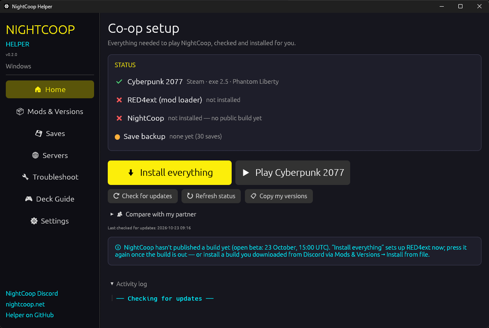
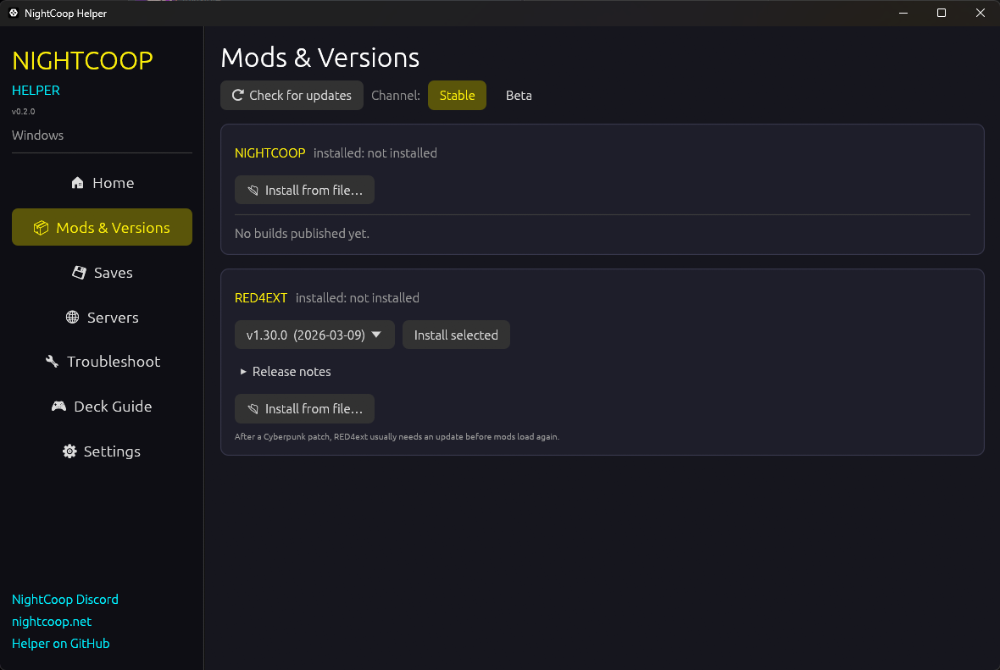
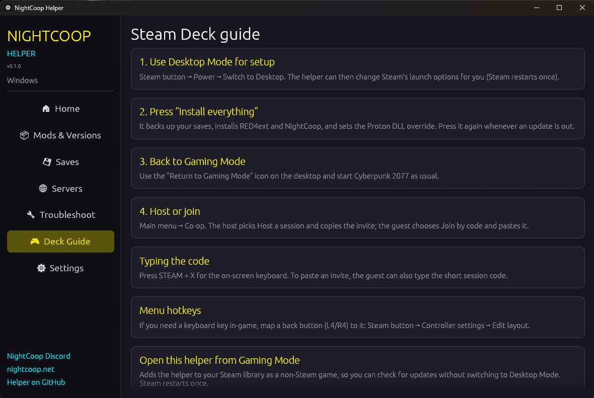

<div align="center">

# ⚡ NightCoop Auto-Installer

### One-click setup for the **NightCoop** co-op mod for **Cyberpunk 2077**
#### Built for the **Steam Deck** · works on **Windows** · one portable file, nothing to install

[](https://github.com/clawdroppin/Cyberpunk2077-NightCOOP-AutoInstaller-windows-steamdeck-/releases/latest)
[](#-steam-deck)
[](#-windows)
[](#-building-from-source)



**[⬇ Steam Deck download](https://github.com/clawdroppin/Cyberpunk2077-NightCOOP-AutoInstaller-windows-steamdeck-/releases/latest/download/NightCoopHelper-SteamDeck.tar.gz)** &nbsp;·&nbsp;
**[⬇ Windows download](https://github.com/clawdroppin/Cyberpunk2077-NightCOOP-AutoInstaller-windows-steamdeck-/releases/latest/download/NightCoopHelper-windows-x64.exe)** &nbsp;·&nbsp;
[All releases](https://github.com/clawdroppin/Cyberpunk2077-NightCOOP-AutoInstaller-windows-steamdeck-/releases)

</div>

---

> [!NOTE]
> This is an **unofficial** fan tool. It is not made by the NightCoop team or CD PROJEKT RED.
> It downloads [RED4ext](https://github.com/WopsS/RED4ext) and [NightCoop](https://nightcoop.net/) from their official sources and installs them for you.
> NightCoop officially targets Windows — on the Steam Deck it runs through Proton.

## ✨ What it does for you

Getting a RED4ext mod running on the Steam Deck normally means Desktop Mode, digging through folders, merging zips and editing Steam launch options by hand. This app does all of it with **one button**:

| | Step | What happens |
|---|---|---|
| 💾 | **Backs up your saves** | Zips your saves first (on the Deck it finds them inside the Proton prefix). |
| 🧩 | **Installs RED4ext** | Latest release from GitHub, checksum-verified, dropped into the right folders. |
| 🌃 | **Installs NightCoop** | Latest build from the official release list, checksum-verified, mirrors as fallback. |
| 🐧 | **Fixes Proton** *(Deck/Linux)* | Adds `WINEDLLOVERRIDES="winmm,version=n,b" %command%` to Steam's launch options, keeping anything you already had. |
| ✅ | **Checks it all** | Green ticks when everything is ready to play. |

Press the same button again whenever an update is out — it only replaces what changed.

### And a lot more

- 🔄 **Update checks** for RED4ext, NightCoop (stable or beta channel) and the helper itself
- 📦 **Version picker** — install any listed NightCoop build or RED4ext release, with notes, game versions and protocol numbers
- ⏪ **One-click rollback** to your previous NightCoop build (last 3 kept)
- 📂 **Install from file** — `.zip` / `.7z` builds shared on Discord, even with an extra wrapper folder
- 🔌 **Mods off / on** — one tap on Home for an unmodded game; everything is kept and the helper offers to turn mods back on whenever you open it again
- ⚠ **Game-update alert** — warns when a Cyberpunk patch arrived after the mods were installed (the usual reason mods suddenly stop working)
- 👥 **Compare with my partner** — paste their versions and see ✔/✖ for NightCoop, RED4ext, game and Phantom Liberty
- 🌐 **Keeps your `servers.txt`** across updates; view, edit and copy it
- 🐞 **Bug report zip** — RED4ext + NightCoop logs and a diagnostics summary in one file
- 📋 **Copy my versions** — paste to your partner to confirm you run the same build
- ☁ **Save safety** — automatic backups, restore with undo, export a backup anywhere, an **extra backup folder** (SD card, USB stick or a synced cloud folder like Dropbox/OneDrive/Syncthing), and a **Steam Cloud** status card
- 🎮 **Add to Steam** — puts the helper in your library so it opens from **Gaming Mode**
- 🔍 Finds the game in every Steam library (SD card too), plus GOG and Epic on Windows
- 🖐 Big, touch-friendly UI sized for the Deck's 1280×800 screen, adjustable scale

<div align="center">


</div>

---

## 🎮 Steam Deck

1. **Switch to Desktop Mode** — `STEAM` button → **Power** → **Switch to Desktop**.
2. **Download** [`NightCoopHelper-SteamDeck.tar.gz`](https://github.com/clawdroppin/Cyberpunk2077-NightCOOP-AutoInstaller-windows-steamdeck-/releases/latest/download/NightCoopHelper-SteamDeck.tar.gz) (open this page in the desktop browser).
3. In the **Downloads** folder: right-click the file → **Extract** → **Extract archive here**.
4. Open the new `NightCoopHelper` folder and **double-click `NightCoopHelper`**.
   <sub>Nothing happens? Right-click it → **Properties** → **Permissions** → tick **Is executable**.</sub>
5. Press **⬇ Install everything**. When asked, let it restart Steam (that's how the launch option gets saved).
6. Double-click **Return to Gaming Mode** on the desktop and start **Cyberpunk 2077**.
7. In the main menu open **Co-op** → **Host a session**, or **Join by code** to join a friend.

> [!TIP]
> On the **🎮 Deck Guide** page, press **Add to Steam**. The helper then shows up in your library under *Non-Steam*, so you can check for updates without leaving Gaming Mode.
> Typing an invite code in game: press **STEAM + X** for the on-screen keyboard.

## 🪟 Windows

1. Download [`NightCoopHelper-windows-x64.exe`](https://github.com/clawdroppin/Cyberpunk2077-NightCOOP-AutoInstaller-windows-steamdeck-/releases/latest/download/NightCoopHelper-windows-x64.exe) and put it in any folder (a USB stick works).
2. Run it. If SmartScreen warns about an unknown app: **More info** → **Run anyway** (the exe isn't code-signed).
3. Press **⬇ Install everything**, then **▶ Play**.

No launch options are needed on Windows — RED4ext loads by itself. Steam, GOG and Epic installs are detected automatically, or pick the game folder in **Settings**.

## 🔌 Playing without mods

Press **🔌 Mods off** on the Home page. RED4ext and NightCoop are moved aside, so Cyberpunk starts exactly like an unmodded game. Nothing is deleted: next time you open the helper it shows **Turn mods back ON**, and **Install everything** turns them back on too. Your saves are never touched.

## ☁ Saves & the cloud

- **Steam Cloud keeps working** with or without mods. Steam uploads saves when you quit the game and downloads them when you start it — there's no command to force a sync, so to sync now just start the game, reach the main menu and quit. The **Saves** page shows how many files Steam Cloud holds and when it last uploaded.
- **Backups are your undo button**: Steam Cloud also syncs mistakes. The helper backs up saves before every install, keeps the newest 10, and can restore any of them (your current saves are backed up first).
- **Extra copy**: on the Saves page, pick a second folder — the SD card, a USB stick, or a folder synced by Dropbox / OneDrive / Google Drive / Syncthing — and every backup is copied there too. **Export…** saves any single backup wherever you like.

## 🤝 Playing together

- **Everyone needs the same NightCoop build** (builds with the same *protocol* number play together). Use **📋 Copy my versions** on the Home page and compare.
- **Host:** Co-op → Host a session → pick a save or New game → **Copy the invite** and send it.
- **Guest:** Co-op → Join by code → paste the invite.
- Saves made with **Phantom Liberty** won't load in a session hosted without it.
- Tip from the NightCoop docs: play in **Borderless window**; exclusive fullscreen freezes for a second on Alt+Tab.

## 🛠 Troubleshooting

<details>
<summary><b>No “Co-op” item in the main menu</b></summary>

RED4ext didn't load the plugin. Open **🔧 Troubleshoot** — the diagnostics show whether RED4ext, NightCoop and (on the Deck) the Proton launch option are in place, plus the relevant lines from RED4ext's log, which say why a plugin was skipped. Pressing **Install everything** again repairs missing pieces.
</details>

<details>
<summary><b>It worked yesterday, broke after a Cyberpunk update</b></summary>

Game patches break RED4ext and its plugins until they're updated. Press **⟳ Check for updates**, then **⬆ Update everything**. Each NightCoop build lists the game versions it supports on **📦 Mods & Versions**.
</details>

<details>
<summary><b>The game won't start on the Deck</b></summary>

Cyberpunk 2077 → ⚙ Properties → Compatibility → try **Proton Experimental** or the newest Proton. If it still fails, press **🔌 Mods off** on Home to check that the game itself starts, then create a **bug report**.
</details>

<details>
<summary><b>The helper says Steam can't be restarted</b></summary>

That happens in Gaming Mode. Switch to Desktop Mode and press the button again, or copy the launch option shown on **📦 Mods & Versions** into Cyberpunk 2077 → Properties → Launch Options yourself.
</details>

<details>
<summary><b>Reporting a bug</b></summary>

**🔧 Troubleshoot → 🐞 Create bug report** writes a zip to your Desktop. Send it to the [NightCoop Discord](https://discord.gg/6UvSdSmaTM) (mod bugs) or open an [issue here](https://github.com/clawdroppin/Cyberpunk2077-NightCOOP-AutoInstaller-windows-steamdeck-/issues) (helper bugs), with the time it happened and whether you were host or guest.
</details>

## 🗂 Where things go

| What | Where |
|---|---|
| Helper settings, save backups, rollbacks, downloads | `NightCoopHelper-data/` next to the helper — move them together |
| Mods while switched off | `<game>/_NightCoopHelper_mods_off/` |
| RED4ext | `<game>/bin/x64/winmm.dll`, `<game>/red4ext/` |
| NightCoop | `<game>/red4ext/plugins/NightCoop/` (disabled: `<game>/red4ext/NightCoop.disabled/`) |
| Steam launch-option backups | `NightCoopHelper-data/backups/steam-localconfig/` |
| Bug reports | your Desktop |

**Uninstalling:** 📦 Mods & Versions → *Uninstall* for NightCoop and RED4ext, and *Remove* for the launch option. Then delete the helper folder. Your saves are never deleted.

## 🔒 Safety

- Downloads come only from `github.com/WopsS/RED4ext` and `nightcoop.net`, and are **SHA-256 verified** when the source publishes a checksum.
- Saves are backed up before every install; Steam's config is backed up before every edit.
- The previous NightCoop build is kept for rollback, and "Mods off" only moves files — it never deletes them.
- Everything is open source in this repo — see [`src/`](src).

## 🧑‍💻 Building from source

Requires Rust (stable). On Windows:

```powershell
rustup target add x86_64-unknown-linux-gnu   # one-time, for the Steam Deck build
cargo install cargo-zigbuild                 # one-time
python -m pip install --user ziglang         # one-time
.\build.ps1                                  # tests + Windows exe + Linux binary → dist\
```

The Windows exe uses a static C runtime; the Linux binary targets glibc 2.28 and only links libc/libm/libdl/libpthread (graphics libraries are loaded at runtime), so it runs on any SteamOS 3.

Contributing or using an AI coding agent? Start with [`AGENTS.md`](AGENTS.md).

---

<div align="center">
<sub>NightCoop is an unofficial fan modification by its own authors — <a href="https://nightcoop.net/">nightcoop.net</a>. Cyberpunk 2077 is a trademark of CD PROJEKT S.A. This helper is not affiliated with either.</sub>
</div>
